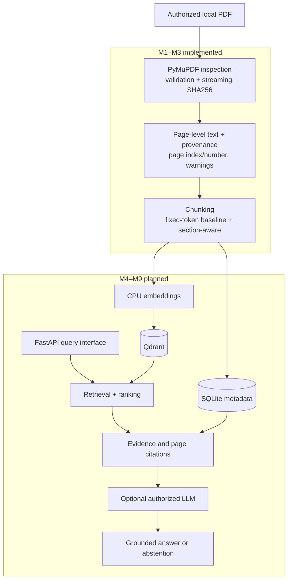

# Industrial RAG Copilot

> CPU-first Retrieval-Augmented Generation for evidence-grounded industrial technical documentation.

**Status (16 November 2026):** the ingestion and chunking foundations are implemented. **M1** (CPU-only development environment), **M2** (PDF inspection with page provenance) and **M3** (page-aware chunking) are complete, tested and merged into `main`. M3 landed through [PR #14](https://github.com/hafizshah101-code/industrial-rag-copilot/pull/14) and is recorded in [`docs/milestones/M3_chunking.md`](docs/milestones/M3_chunking.md). Embeddings, retrieval, grounded generation and the local API are **not** implemented yet.

## What works today

Python 3.12 is required. All commands below are run from the repository root with the project virtual environment (PowerShell):

```powershell
py -3.12 -m venv .venv
.\.venv\Scripts\python.exe -m pip install -r requirements.txt -r requirements-dev.txt

# inspect one local PDF (JSON to stdout) - use any PDF you are authorized to process
.\.venv\Scripts\python.exe scripts\inspect_pdf.py data\your-manual.pdf

# one line per page
.\.venv\Scripts\python.exe scripts\inspect_pdf.py data\your-manual.pdf --summary

# write the structured result to a file
.\.venv\Scripts\python.exe scripts\inspect_pdf.py data\your-manual.pdf --output data\inspection.json

# chunk one local PDF and print a per-document summary
.\.venv\Scripts\python.exe scripts\chunk_pdf.py data\your-manual.pdf --strategy section_aware --summary

# quality gates
.\.venv\Scripts\python.exe -m pytest -q
.\.venv\Scripts\python.exe -m ruff check .
.\.venv\Scripts\python.exe -m ruff format --check .
```

An encrypted PDF is opened through an interactive prompt:

```powershell
.\.venv\Scripts\python.exe scripts\inspect_pdf.py data\locked.pdf --ask-password
```

A password is never accepted as a command-line argument, so it cannot leak into a process listing or shell history.

`data/` is git-ignored, so a fresh clone contains no PDF: place an authorized document there yourself. The test suite does not need one — every fixture is a synthetic PDF generated in a temporary directory at test runtime.

**Last recorded local run (13 November 2026, this laptop):** `pytest -q` → 63 passed (3 environment checks + 60 inspector cases); `ruff check` → clean; `ruff format --check` → 13 files formatted. These numbers come from a local terminal, **not** from CI — automated CI is milestone M9 and is not configured.

**Most recent recorded local run (16 November 2026, this laptop):** `pytest -q` → 154 passed (3 environment checks + 60 inspector cases + 91 chunking cases); `ruff check` → clean; `ruff format --check` → 23 files formatted. This is again a local terminal result, **not** a CI result: no workflow is configured, so no CI status exists to report.

## Implemented versus planned

| Area | State | Reference |
|---|---|---|
| CPU-only Python environment, pinned dev tools, SSH-signed commits | Implemented (M1) | `docs/milestones/M1_environment_setup.md` |
| PDF validation, streaming SHA256 document id, page-level text with provenance, heuristic page classification, OCR candidates, table/diagram indicators | Implemented (M2) | `docs/ingestion/pdf_inspection.md` |
| CLI inspector with JSON output and interactive password prompt | Implemented (M2) | `scripts/inspect_pdf.py` |
| Fixed-token-estimate and section-aware chunking with page and section provenance | Implemented (M3, merged in PR #14) | `docs/ingestion/chunking.md`, `docs/milestones/M3_chunking.md` |
| CPU embeddings, semantic retrieval | Planned (M4) | GitHub issue #4 |
| BM25, metadata filters, hybrid retrieval benchmarking | Planned (M5) | GitHub issue #5 |
| Grounded answers with citations and abstention | Planned (M6) | GitHub issue #6 |
| Gold evaluation dataset and regression tests | Planned (M7) | GitHub issue #7 |
| Evidence-linked component graph | Planned (M8) | GitHub issue #8 |
| FastAPI demo, minimal UI, CI and privacy checks | Planned (M9) | GitHub issue #9 |

No cloud service, embedding API, LLM or OCR engine is called by the implemented code. OCR candidates are only *flagged* for later handling.

## Architecture

`IMPLEMENTED` marks what M1–M3 delivered and what runs today. `PLANNED` marks future capabilities, which are design intent only.



Every extracted page keeps a zero-based `page_index` and a one-based `page_number`, so any later chunk, retrieval hit or generated sentence can be traced back to the page it came from.

## Repository layout

```
app/ingestion/      PDF inspection module (M2)
app/chunking/       chunking strategies with page and section provenance (M3)
scripts/            command-line entry points
tests/              pytest suites (synthetic fixtures only)
docs/               architecture, roadmap, policies, module and milestone reports
data/               local PDFs and derived artefacts - git-ignored, never committed
```

## Environment

**Implemented today:** Windows 11 laptop, Intel i5-8365U, 16 GB RAM, integrated graphics (no discrete GPU), Python 3.12.10 in `.venv`, PyMuPDF 2.1.

**Planned:** a compact CPU sentence-embedding model, Qdrant for vectors, SQLite for document/chunk metadata, FastAPI for a local interface. Neo4j, OCR engines and multimodal figure retrieval remain future experiments, not prerequisites.

## Quality gates

```powershell
.\.venv\Scripts\python.exe -m pytest -q
.\.venv\Scripts\python.exe -m ruff check .
.\.venv\Scripts\python.exe -m ruff format --check .
git diff --check
```

**CI is not configured.** `.github/workflows/` holds only a `.gitkeep` placeholder, so every result in this repository is a recorded local measurement and is labelled as such. Automated CI is scoped to M9.

## Limitations

- Page classification and the image/table/diagram indicators are **heuristics**, not detection of scanned content.
- No OCR is executed; pages are only flagged as OCR candidates.
- Tables without drawn lines, and tables embedded in images, are not detected.
- Default reading order may interleave multi-column text.
- One document per call; there is no batch ingestion runner yet.
- No accuracy claim exists for parsing, chunking or retrieval; those require the gold evaluation set (M7).

## Privacy

Never commit vendor PDFs, copyrighted extracts, service records, customer details, secrets, model weights or local indexes. Keep manuals in git-ignored `data/`. Publicly accessible manuals do not automatically grant redistribution rights. Only synthetic fixtures belong in public demos. The test suite asserts that no restricted document type is tracked in Git.

## Reading

- [Architecture](docs/architecture.md)
- [Learning roadmap](docs/learning-roadmap.md)
- [Dataset and licensing policy](docs/dataset-policy.md)
- [PDF inspection module reference](docs/ingestion/pdf_inspection.md)
- [Milestone 1 report](docs/milestones/M1_environment_setup.md)
- [Milestone 2 report](docs/milestones/M2_pdf_inspection.md)
- [Issues](../../issues)

## License

Not selected; no license is granted yet.
