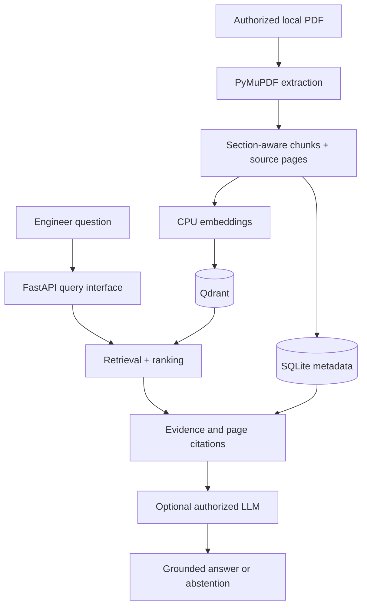

# Industrial RAG Copilot

> CPU-first Retrieval-Augmented Generation for evidence-grounded industrial technical documentation.

**Status:** Documentation-only foundation; not yet a working RAG service.

## Purpose
Learn and benchmark parsing, chunking, embeddings, semantic and hybrid retrieval, source citations, abstention and RAG evaluation on technical manuals.

## Proposed architecture

## Environment
Windows laptop with Intel i5-8365U, 16 GB RAM and integrated graphics. No discrete GPU required. Local-first Python, PyMuPDF, compact Sentence Transformers embeddings, Qdrant and SQLite. Neo4j and advanced OCR are future experiments, not prerequisites.

## Roadmap
1. M1 — Setup, PDF inspection and page provenance.
2. M2 — Chunking and CPU semantic search.
3. M3 — BM25, filters, hybrid search benchmarking.
4. M4 — Grounded generation, citations and abstention.
5. M5 — Gold evaluation dataset and regression tests.
6. M6 — Evidence-backed component graph pilot.
7. M7 — FastAPI demo, CI, privacy safeguards.

Read [architecture](docs/architecture.md), [learning roadmap](docs/learning-roadmap.md), [dataset policy](docs/dataset-policy.md), and [issues](../../issues).

## Development status
No install or run commands yet: these are delivered during milestone M1. Each milestone requires a reproducible demonstration, tests, documented limitations and measured results. Do not claim unmeasured accuracy.

## Privacy
Never commit vendor PDFs, copyrighted extracts, service records, customer details, secrets, model weights or local indexes. Keep manuals in git-ignored `data/`. Publicly accessible manuals do not automatically grant redistribution rights. Only synthetic fixtures belong in public demos.

## License
Not selected; no license is granted yet.
